# SafeLane-RL: Safe Reinforcement Learning for Highway Driving and On-Ramp Merging

> **AI Course, Assignment 2 (Mini Project): Real-Life Use Cases of Reinforcement Learning** · IIT Jodhpur · 2026
> **Team:** _Gokul Bansal (B24CM1025), Likhita (B24CM1043)_ · **Report:** [`report/main.pdf`](report/main.pdf)

An autonomous car learns, **purely by trial and error**, to control its speed, change lanes, avoid collisions
and **merge from an on-ramp into dense highway traffic**. Our agent, **SafeLane**, treats safety as a *hard
budget* (a constrained MDP solved with PPO-Lagrangian) rather than as one more term in the reward. It reads
traffic with an **attention network**, and was tested on **26 traffic scenarios, 3 random seeds and 49,250 evaluation
episodes** against 10 other learning agents and a competent classical rule-based driver.

| SafeLane merging from the ramp | Plain PPO: same episode, crashes | Rule-based IDM+MOBIL: same episode, crashes |
|:---:|:---:|:---:|
| 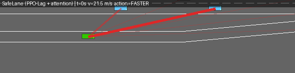 | 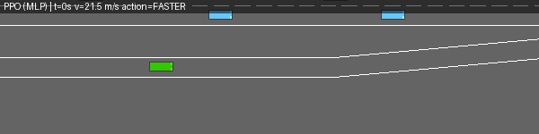 | 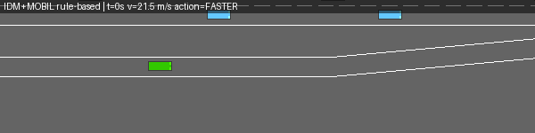 |

*Red lines show where SafeLane's attention network is "looking". Green car = our agent; blue cars = traffic.
This episode was chosen to illustrate the difference; aggregate numbers are below.*

### Headline results (3 seeds × 50 episodes; 95% confidence interval in brackets)

| | **SafeLane** (120k steps) | **SafeLane** (400k, long budget) | Plain PPO | Plain DQN | Rule-based IDM+MOBIL |
|---|---|---|---|---|---|
| **Highway** (official `highway-v0`, 50 cars): collisions | **0.0%** [0, 0] | 0.7% [0, 2.7] | 33.3% | 8.7% | 0.0% |
| Highway: return (driving efficiency, higher = better) | **33.0** | 32.8 | 28.0 | 30.1 | 30.1 |
| **On-ramp merge** (our `RampMerge-v0`): success | 96.7% [92.7, 100] | **99.3%** [97.3, 100] | 51.3% | — | 88.0% |
| Merge at **2× traffic density** (never seen in training) | **94.0%** | **94.0%** | 6.0% | — | 72.0% |

For context: typical student projects on highway-env report 2–75% highway collisions, and a published DQN/TRPO baseline on
highway-env's merge crashes 40–50% of the time. A 2025 research paper (constrained RL **plus** an MPC safety controller) reports
99.0–99.5% ego-merge success; we reach 99.3% without the extra controller. The full comparison, with caveats, is in
[Part D](#part-d-how-our-results-compare-to-other-rl-projects).

---

## How to read this README

It is written for someone who **has never studied reinforcement learning**. You can read it top to bottom
before the viva.

* **[Part A](#part-a-reinforcement-learning-from-zero)** teaches RL from zero, always using this project as the example.
* **[Part B](#part-b-the-project-in-detail)** explains exactly what we built and why.
* **[Part C](#part-c-results-and-what-they-mean)** shows every result and how to interpret it, including the bad ones.
* **[Part D](#part-d-how-our-results-compare-to-other-rl-projects)** compares us with other RL projects solving the same problem.
* **[Part E](#part-e-design-choices-and-trade-offs)** covers each design decision, the alternatives and the trade-offs.
* **[Part F](#part-f-installation-usage-and-reproduction)** shows how to install, run, retrain and reproduce everything.
* **[Part G](#part-g-viva-preparation-likely-questions-with-answers)** is viva preparation: 46 likely questions with answers.
* **[Part H](#part-h-limitations-future-work-and-what-we-learned-about-highway-env)** covers limitations, future work and quirks of highway-env.

---

## Contents

- [Part A: Reinforcement learning from zero](#part-a-reinforcement-learning-from-zero)
- [Part B: The project in detail](#part-b-the-project-in-detail)
- [Part C: Results and what they mean](#part-c-results-and-what-they-mean)
- [Part D: How our results compare to other RL projects](#part-d-how-our-results-compare-to-other-rl-projects)
- [Part E: Design choices and trade-offs](#part-e-design-choices-and-trade-offs)
- [Part F: Installation, usage and reproduction](#part-f-installation-usage-and-reproduction)
- [Part G: Viva preparation](#part-g-viva-preparation-likely-questions-with-answers)
- [Part H: Limitations, future work, highway-env quirks](#part-h-limitations-future-work-and-what-we-learned-about-highway-env)
- [References](#references)

---

# Part A: Reinforcement learning from zero

## A1. The idea in one paragraph

**Reinforcement learning (RL)** is learning by trial and error. An **agent** (here, the car's driving software)
repeatedly looks at the world (**state**), chooses something to do (**action**), and receives a number telling it
how good that was (**reward**). Nobody tells it the correct action, unlike supervised learning where every example
has a label. It has to discover, from millions of attempts, which actions lead to the most total reward over time.
It is like learning to drive with no instructor: the only feedback is "+ you made progress", "+ you are going at a good
speed", and a very negative signal when you crash.

```
            ┌──────────────── action a_t (e.g. "change lane left") ───────────────┐
            │                                                                      ▼
   ┌────────┴────────┐                                                   ┌──────────────────┐
   │      AGENT      │                                                   │   ENVIRONMENT    │
   │ (neural network │                                                   │ (highway-env     │
   │  = the policy)  │ ◀──── state s_{t+1}, reward r_{t+1} ─────────────│  traffic sim)    │
   └─────────────────┘                                                   └──────────────────┘
```

One pass around this loop is a **step** (one second of driving in our setup). A full drive from start until a crash or the
time limit is an **episode**. Training is millions of steps or thousands of episodes of this loop.

## A2. Vocabulary, with the project as the example

| Term | Meaning | In SafeLane |
|---|---|---|
| **State / observation** *s* | What the agent sees | A table of the nearest 5 or 15 cars: whether present, relative position x/y, relative velocity vx/vy, heading |
| **Action** *a* | What it can do | 5 choices: `LANE_LEFT`, `IDLE`, `LANE_RIGHT`, `FASTER`, `SLOWER` |
| **Reward** *r* | The score after each step | Highway: + for speed, + for the right lane, − for a crash. Ramp: + for speed, +1 once on merging, −1 for a crash |
| **Episode** | One drive | 30–40 s on the highway; on the ramp, until merged and past the merge zone, crashed, or 25 s |
| **Policy** π(a\|s) | The agent's strategy: state → action (probabilities) | A neural network |
| **Return** *G* | Total (discounted) reward from now on | What the agent tries to maximise |
| **Discount** γ | How much the future counts (0–1) | γ = 0.9: a reward 10 s away is worth 0.9¹⁰ ≈ 35% of one now |
| **Value** V(s) | Expected return from state *s* | "How good is my situation right now?" |
| **Q-value** Q(s,a) | Expected return after taking *a* in *s* | "How good is changing lane left right now?" |
| **Exploration** | Trying non-greedy actions to learn | ε-greedy (DQN) or a stochastic policy (PPO) |
| **Training step / timestep** | One interaction with the simulator | Our budgets: 50k–500k steps |
| **Seed** | Random-number starting point | We train each method 3 times (seeds 0, 1, 2) to show results are not luck |

## A3. The mathematics, minimal and essential

RL problems are modelled as a **Markov Decision Process (MDP)**, a tuple *(S, A, P, R, γ)*:
* *S*: the states, *A*: the actions,
* *P(s'|s,a)*: how the world changes (here, the traffic simulator, which the agent does **not** know),
* *R(s,a)*: the reward, *γ*: the discount.

"Markov" means the current state contains everything needed to predict the future.

The agent wants a policy π that maximises the **expected discounted return**

$$J(\pi) = \mathbb{E}_\pi\Big[\sum_{t=0}^{T} \gamma^t r_t\Big].$$

**Why discount?** Without γ, a 40-step episode and an infinite one cannot be compared. Discounting also makes the
agent prefer reward sooner. The effective planning horizon is about 1/(1−γ): γ = 0.9 means about 10 decisions (10 s) ahead.

**Bellman equation.** This is the key recursive idea behind value-based RL:

$$Q^*(s,a) = \mathbb{E}\big[r + \gamma \max_{a'} Q^*(s',a')\big].$$

It says the value of an action is the immediate reward plus the discounted value of acting optimally afterwards.

## A4. Value-based RL: DQN and its improvements

**Q-learning** keeps an estimate Q(s,a) and nudges it towards the Bellman target
*y = r + γ max_a' Q(s',a')*. With continuous states (car positions), a table is impossible, so **DQN** (Deep Q-Network,
Mnih et al. 2015) uses a neural network Q_θ(s,a) and minimises (Q_θ(s,a) − y)². Two tricks make it stable:

1. **Replay buffer.** Store past transitions (s, a, r, s') and train on random mini-batches. This breaks the correlation
   between consecutive steps and reuses data, which is why DQN is **sample-efficient**.
2. **Target network.** Compute *y* with a slowly-updated copy of the network, so the target does not chase itself.

The agent explores with **ε-greedy**: a random action with probability ε (decaying from 1.0 to 0.05), otherwise the best one.

Improvements we implemented or used:

| Variant | Problem it fixes | How |
|---|---|---|
| **Double DQN** | `max` over noisy Q-values *over-estimates* (it picks lucky estimates) | The online network **chooses** a* = argmax Q_online(s',a); the target network **evaluates** Q_target(s',a*) |
| **Dueling DQN** | In many states all actions are equally good (empty road), so learning each Q separately is wasteful | Split the network into a state value V(s) plus advantages A(s,a): Q = V + A − mean(A) |
| **n-step returns** | Rewards propagate back only one step per update, so learning is slow | Target = r_t + γ r_{t+1} + γ² r_{t+2} + γ³ max Q(s_{t+3}) |
| **QR-DQN** (distributional) | Q is only an *average*; it hides rare disasters | Learn 50 quantiles of the whole return distribution |
| **CVaR acting** | Risk-neutral choice ignores the bad tail | Choose the action whose *worst 25%* of outcomes is best (risk-averse) |

Our **D3QN** = Double + Dueling + 3-step, written by us on top of Stable-Baselines3's plain DQN
([`safelane/agents/d3qn.py`](safelane/agents/d3qn.py)).

## A5. Policy-gradient RL: PPO

Instead of learning values and then acting greedily, **policy-gradient** methods directly adjust the policy network's
parameters θ in the direction that makes good actions more likely:

$$\nabla_\theta J = \mathbb{E}\big[\nabla_\theta \log \pi_\theta(a|s)\, \hat A(s,a)\big].$$

* **Advantage Â(s,a).** How much better action *a* was than average in state *s*. A second network, the **critic** V(s), provides
  the baseline. This combination is called **actor-critic**.
* **GAE** (Generalised Advantage Estimation, λ = 0.95). A smooth trade-off between low-variance (bootstrapped) and
  low-bias (Monte-Carlo) advantage estimates.
* **PPO** (Proximal Policy Optimization, Schulman et al. 2017). Big policy updates can destroy a good policy, so PPO
  **clips** the update. The probability ratio ρ = π_new/π_old is kept within [1−ε, 1+ε] with ε = 0.2:
  $$L^{CLIP} = \mathbb{E}\big[\min(\rho \hat A,\ \mathrm{clip}(\rho, 1-\epsilon, 1+\epsilon)\hat A)\big].$$
* **On-policy.** PPO can only learn from data collected by the *current* policy, so data is thrown away after each update. That makes it
  less sample-efficient than DQN, but very **stable**, and easy to run with **many parallel simulators** (we use 8).
* **Entropy bonus** (0.01). This keeps the policy a little random so it keeps exploring.

## A6. Safe RL: constraints instead of penalties

The naive way to make an agent safe is a big crash penalty in the reward. The trouble is that the right size is unknown. Too
small and the agent crashes for speed; too large and it learns to crawl. Re-tuning it for every scenario is guesswork.

A **Constrained MDP (CMDP)** separates the two goals:

$$\max_\pi J_r(\pi) \quad\text{subject to}\quad J_c(\pi) = \mathbb{E}\Big[\sum_t c_t\Big] \le d,$$

where *c_t* is a **cost** (a "safety violation" counter) and *d* is a **budget** you choose in interpretable units, for example
"at most 2 unsafe events per episode". It is solved with the **Lagrangian** L = J_r − λ(J_c − d): the agent maximises
*r − λc*, while λ (the **Lagrange multiplier**) is **learned**. When the agent is too unsafe, λ goes up, making safety
more important; when it is safe enough, λ goes down and speed matters again. We update λ with a **PID controller**
(Stooke et al. 2020), which reacts faster and oscillates less than plain gradient ascent.

A different approach is a **shield** / **action masking**: a hand-written rule forbids dangerous actions. It is useful,
but it is not RL, and as Part C shows it can backfire.

## A7. Neural networks for traffic: why attention

The observation is a list of cars. A plain **MLP** (multi-layer perceptron) receives the flattened list, so "car in slot 1"
and "car in slot 2" are different inputs, and the network must learn the same skill for every slot. It is also
**order-sensitive** and has a fixed size.

**Attention** (as in Transformers) fixes this. Each car is encoded by the *same* small network into a vector. The ego car forms a
**query** ("what matters to me?"), every car offers a **key** ("what I am") and a **value** ("what I tell you"). The
attention weights softmax(q·k/√d) decide how much each car contributes. The result is **permutation-invariant**
(car order does not matter), works with any number of cars, and the weights can be **visualised**: these are the red
lines in our GIFs. Our attention policy has **46.7k** parameters, against **146k** for the MLP PPO, and on the merging task it works far better.

## A8. Generalisation: domain randomisation and curriculum

An RL agent is only as good as the situations it trained on. **Domain randomisation (DR)** changes the training world
every episode: traffic density, aggressive or cautious drivers, per-car reaction times. The agent must then learn behaviour that
works in all of them. A **curriculum** starts easy (sparse traffic) and gets harder once the agent succeeds. We test both,
and then evaluate on conditions *outside* the training range to see whether the agent truly generalises.

## A9. How to evaluate RL honestly

RL results are noisy: the same algorithm with a different random seed can perform very differently. Agarwal et al.
(NeurIPS 2021, *"Deep RL at the Edge of the Statistical Precipice"*) showed that many published comparisons are not
statistically meaningful. We follow their advice:

* **Several seeds** (3 per method) and **many evaluation episodes** (50 per scenario) on **fixed seeds never used in training**.
* **Confidence intervals** (95%) by **bootstrap**: resample seeds, then episodes, thousands of times and look at the spread.
* **IQM** (interquartile mean): the mean of the middle 50% of scores. It is more robust than the mean and more efficient than the median.
* **Probability of improvement** P(X > Y): the chance a random run of method X beats a random run of method Y.

## A10. Glossary (quick reference)

* **Actor-critic**: a policy network (actor) plus a value network (critic).
* **Bootstrapping** (in TD learning): updating an estimate from another estimate (Q(s') in the target).
* **Bootstrap** (statistics): resampling to estimate uncertainty.
* **Clip range**: PPO's ε, the maximum allowed policy change per update.
* **Epsilon-greedy**: act randomly with probability ε.
* **Exploration/exploitation trade-off**: try new things vs use what works.
* **GAE λ**: bias/variance knob for advantages.
* **Horizon**: how far ahead the agent effectively plans, about 1/(1−γ).
* **Off-policy**: can learn from old data (DQN). **On-policy**: needs fresh data (PPO).
* **Sample efficiency**: performance per simulator step.
* **Stochastic policy**: outputs probabilities over actions.
* **TTC** (time-to-collision): gap ÷ closing speed; below about 2 s is dangerous.
* **Headway**: gap ÷ own speed; the "2-second rule" says keep ≥ 2 s.
* **IDM/MOBIL**: classical car-following and lane-change models used for the traffic.
* **RSS**: Mobileye's formal minimum safe distance.

---

# Part B: The project in detail

## B1. Real-world problem

Lane changes and on-ramp merges are among the riskiest highway manoeuvres. The driver must judge gaps in moving traffic,
adapt speed, and commit within a limited stretch of road. Rule-based systems such as IDM+MOBIL are predictable but rigid:
in dense traffic they either refuse to merge or merge unsafely. We frame **tactical driving decisions** (which lane, faster or
slower) as an RL problem, with safety as an explicit constraint, as recommended by the safe-RL literature. Low-level steering
and throttle are handled by controllers, as in real autonomous-driving stacks, where a planner chooses manoeuvres and a controller executes them.

## B2. The simulator: highway-env

We use **[highway-env](https://github.com/Farama-Foundation/HighwayEnv) 1.12.1** (Farama Foundation), the standard RL
benchmark for tactical driving.

* **Vehicles** move with a kinematic bicycle model. Each **agent decision lasts 1 s**. The simulator advances physics
  5×/s while training (fast) and 15×/s while evaluating (more accurate collision checks).
* **Traffic cars** are not scripted replays. They are reactive drivers following two classical models:
  * **IDM** (Intelligent Driver Model) for speed: a = a_max[1 − (v/v₀)^δ − (s*/s)²], with desired gap s* = s₀ + vT + vΔv/(2√(a_max·b)).
    They speed up towards their desired speed v₀ but brake to keep a safe gap s* that grows with speed and closing speed.
  * **MOBIL** for lane changes: change lane if it improves your acceleration by more than a threshold without forcing the new
    follower to brake harder than a safe limit.
* To make traffic **heterogeneous**, we wrote per-car random drivers ([`safelane/envs/vehicles.py`](safelane/envs/vehicles.py)):
  each car samples its own time gap T (0.5–2.5 s), comfort acceleration, politeness and speed preference. There are three
  populations: *randomised*, *aggressive* and *cautious*.

## B3. Scenarios

| Scenario | What it tests | Details |
|---|---|---|
| **Highway** (`highway-fast-v0` for training, `highway-v0` for testing) | speed control, lane changing, collision avoidance | 3 lanes and 20 cars (train) / 4 lanes and 50 cars, 40 s (official benchmark test) |
| **RampMerge-v0** (**new, ours**) | safe merging | the ego **starts on the on-ramp** and must merge into a 2-lane highway within an 80 m merge zone before the ramp ends at a barrier |
| `merge-v1` (stock) | transfer test | ego on the **main road**, a traffic car merges in (ego should make room) |

**Why we built RampMerge:** highway-env's own merge scenario puts our car *on the main road*. The merging car is a
computer-controlled vehicle, and there is no success signal. It cannot measure "merging success rate", which our
proposal promised. [`safelane/envs/ramp_merge.py`](safelane/envs/ramp_merge.py) spawns the ego on the ramp, populates the
main road with traffic at a configurable density, and returns `info["is_success"] = merged and passed the merge zone without crashing`.

**A bug we found and fixed in highway-env:** to find the car ahead across road segments, highway-env 1.12 links segments
**by lane number**. On merge roads the ramp is lane 0 in one segment but lane 2 in the next, so a car on the ramp
"saw" main-road cars as being in front of it. [`safelane/envs/geometric_road.py`](safelane/envs/geometric_road.py) links
segments by geometry instead, matching where one lane ends to where the next begins. A unit test checks this.

## B4. RL formulation (S, A, R, cost, γ)

**State S.** The *Kinematics* observation: a matrix with one row per car (row 0 = our car, then the nearest cars sorted by distance).
Values are relative to our car and normalised to [−1, 1] with a **fixed scale on every road** (x ±200 m,
y ±16 m, v ±80 m/s); empty rows are zeros. (highway-env would otherwise pick the lateral scale from the number of lanes
at the start of each episode, which differs between the ramp, a 3-lane and a 4-lane road. See [B9](#b9-verification-what-an-independent-review-of-our-code-found).)

| Agents | Rows (cars) | Columns (features) | Shape |
|---|---|---|---|
| MLP agents (DQN family, PPO, MaskablePPO) | 5 | presence, x, y, vx, vy | 5 × 5 = 25 numbers |
| Attention agents (PPO-Attn, SafeLane) | 15 | + cos(heading), sin(heading) | 15 × 7 = 105 numbers |

It is **partially observable**: only cars within 200 m are seen, and the MLP sees only the nearest 4.

**Action A.** Discrete, 5 meta-actions: {LANE_LEFT, IDLE, LANE_RIGHT, FASTER, SLOWER}, over target speeds
{10, 15, 20, 25, 30} m/s. A PID controller turns the choice into steering and throttle. The action space is **identical in every
scenario**, so any agent can be tested anywhere.

**Reward R.**
* Highway (highway-env's standard reward): r = normalise(−1·crash + 0.1·(lane index / rightmost) + 0.4·speed_score), in [0, 1],
  where speed_score maps 20–30 m/s onto 0–1. It is ×0 if off-road.
* RampMerge (ours): r = −1·crash + 0.2·speed_score + 1·(merge happened this step).
* A crash also **ends the episode**, so the agent loses all future reward. That loss, more than the −1, is what makes crashing costly.

**Safety cost (SafeLane only).**
c_t = 1[TTC < 2 s] + 1[headway < 1 s] + 10·1[crash], with an episode budget **d = 2**. In words: on average, at most about 2 seconds
per episode of tailgating or near-collision, and crashes count 10×.

**Discount** γ = 0.9, about a 10-second horizon. (highway-env's examples use 0.8, which is too short to plan a merge.)

## B5. The agents we compared

| Agent | Family | Network | Extra | Code |
|---|---|---|---|---|
| Random / Constant speed | trivial baselines | — | lower bounds | [`baselines/policies.py`](safelane/baselines/policies.py) |
| **IDM+MOBIL** | **rule-based** baseline | — | classical AV logic: IDM speed + MOBIL lane changes; on the ramp, speed matching + critical-gap acceptance (0.8 s) + forced merge near the ramp end | same |
| DQN | value-based | MLP 256-256 | official highway-env hyperparameters | SB3 |
| **D3QN** | value-based | dueling MLP | Double-Q + Dueling + 3-step (ours) | [`agents/d3qn.py`](safelane/agents/d3qn.py) |
| QR-DQN / CVaR | distributional | MLP, 50 quantiles | risk-averse acting option | sb3-contrib + [`agents/registry.py`](safelane/agents/registry.py) |
| PPO | policy gradient | MLP 256-256 (actor + critic) | 8 parallel envs | SB3 |
| PPO-Attn | policy gradient | **ego-attention** (ours) | — | [`agents/extractors.py`](safelane/agents/extractors.py) |
| PPO-Attn + curriculum | policy gradient | attention | density curriculum | [`callbacks/curriculum.py`](safelane/callbacks/curriculum.py) |
| PPO-Attn + fixed penalty | constrained, fixed λ = 0.1 | attention | ablation of the Lagrangian | [`agents/ppo_lagrangian.py`](safelane/agents/ppo_lagrangian.py) |
| MaskablePPO (shield) | policy gradient + rule shield | MLP | masks lane changes or speed-ups with TTC < 2.5 s or gap < 8 m | [`wrappers/action_mask.py`](safelane/wrappers/action_mask.py) |
| **SafeLane** | **constrained (PPO-Lagrangian)** | attention | learned λ, budget d = 2 | `ppo_lagrangian.py` + `extractors.py` |
| **SafeLane-Mixed** | constrained | attention | trained on highway **and** ramp at once | same |

## B6. Training setup

* **Library:** Stable-Baselines3 2.9 and sb3-contrib. Everything project-specific was written by us; see [B8](#b8-what-we-wrote-vs-what-we-used).
* **Domain randomisation:**
  * highway: density uniform in [0.7, 2.0], driver population ∈ {IDM, randomised, aggressive, cautious};
  * ramp: density in [0.5, 1.5], same populations.
* **Budgets:**
  * main comparison: 50k steps for the DQN family (1 env), 120k for the PPO family (8 envs), 200k for SafeLane-Mixed;
  * **long-budget** round: 400k for SafeLane, 500k for Mixed, 120k for D3QN.
  * Within a comparison group every method gets the same budget, which keeps it fair.
* **Seeds:** 3 per method (61 training runs in total).
* **Compute:** **10.5 CPU-hours** on a laptop (AMD Ryzen 9 7940HS, 8 cores). No GPU: about 95% of the time is spent in the Python simulator, and our networks are tiny.
* **Speed engineering:**
  * a numpy re-implementation of highway-env's observation, verified identical by tests, about 21% faster;
  * shared-memory worker processes (8 workers in about 470 MB instead of about 3 GB);
  * running 1 PPO job + 1 DQN job at a time, which we measured to be about 3× faster than over-subscribing the CPU.

## B7. Evaluation protocol

* **50 episodes per agent per scenario**, on evaluation seeds 10000–10049, which are never used in training. Actions are deterministic (no exploration).
* **26 scenarios** ([`configs/experiment/eval.yaml`](configs/experiment/eval.yaml)):
  * highway: official `highway-v0`, `highway-fast`, densities 0.5 / 1.5 / 2.0 / 2.5, aggressive drivers, cautious drivers;
  * highway robustness: sensor noise σ = 0.05 / 0.1 / 0.2, 30% of cars randomly invisible, 1-step observation delay;
  * ramp: densities 0.5 / 0.75 / 1 / 1.5 / 2.0, aggressive drivers, cautious drivers;
  * ramp robustness: the same five perception faults;
  * transfer: stock `merge-v1`.
* **Metrics:**
  * collision rate;
  * success rate (highway: no crash for the whole episode; ramp: merged and passed the merge zone; merge-v1: no crash);
  * average speed and return;
  * safety cost;
  * near-miss rate (closest TTC < 1 s without a crash);
  * % of time with TTC < 1.5 s or headway < 1 s;
  * RMS jerk (comfort) and lane changes per km;
  * **RSS** violation rate (time spent closer than Mobileye's formal safe distance).
  * The barrier at the end of the ramp counts for time-to-collision and for the safety cost, because hitting it is a crash.
    Car-following measures (headway, RSS) are computed only with respect to other vehicles.
* **Statistics:** mean with 95% hierarchical-bootstrap CI (resample seeds, then episodes), IQM with stratified-bootstrap CI,
  and probability of improvement ([`safelane/eval/stats.py`](safelane/eval/stats.py)).

## B8. What we wrote vs what we used

Used as libraries (`pip install`): highway-env (simulator), Stable-Baselines3 / sb3-contrib (DQN, PPO, QR-DQN, MaskablePPO
implementations), PyTorch, numpy/pandas/matplotlib, Optuna, Gradio.

Written by us for this project (about 3,300 lines of code plus 265 lines of tests):
* the RampMerge scenario and the geometric-road bug fix;
* the randomised traffic drivers;
* the safety monitor with all its metrics;
* the PPO-Lagrangian (CMDP) and its PID dual update;
* the ego-attention network;
* D3QN;
* CVaR acting;
* the safety shield;
* domain randomisation and the curriculum;
* the observation-noise model;
* the rule-based IDM+MOBIL driver with merge logic;
* the fast observation;
* the evaluation harness and statistics;
* the explainability tools (attention overlay, Integrated Gradients);
* all scripts, tests and the demo.

No code was copied from other repositories.

## B9. Verification: what an independent review of our code found

After the first full round of experiments we ran a line-by-line review of the whole codebase, looking for anything
that could make the reported numbers wrong. It confirmed that the core pipeline was correct:
* metrics and the merge-success definition;
* the PPO-Lagrangian logic and the D3QN target;
* seed separation and caching;
* the statistics and data integrity (49,250 episodes, no duplicates).

It also found four real problems, which we fixed. We then **retrained and re-evaluated everything**. The first-round results are
kept in `archive/` (not part of the submission) for comparison.

| # | Problem | Effect | Fix |
|---|---|---|---|
| 1 | highway-env sets the observation's lateral scale **once per episode from the lanes next to the ego**. On the ramp that is 1 lane (±4 m), so positions were clipped and main-road lanes looked identical | RampMerge agents were partly "blind" | fixed normalisation range for every road (`features_range` in `configs/algo/*.yaml`) + a unit test |
| 2 | Same mechanism: the 3-lane training highway (±12 m) and the 4-lane test highway (±16 m) were scaled differently | train/test input mismatch on `highway-v0` | same fix |
| 3 | Randomised drivers applied their desired-speed factor **twice** (highway-env calls `randomize_behavior()` after construction) | "aggressive"/"cautious" traffic was more extreme than documented | factor applied once + a unit test |
| 4 | Ramp traffic's speed factor was overwritten | aggressive/cautious ramp traffic differed only in gaps | removed the overwrite |

Smaller improvements made at the same time:
* The **rule-based baseline was strengthened.** Its merge logic used IDM's large desired gaps and kept alternating faster/slower without
  committing. It now uses textbook speed matching and critical-gap acceptance, which raised its merge success from 44% to about 88%.
  The comparison is fairer and harder for RL.
* The ramp barrier no longer counts for headway/RSS (see B7).
* The tables now show each method's training budget.
* `scripts/check_numbers.py` automatically verifies every number quoted in this README and in the report against the raw results.

---

# Part C: Results and what they mean

Every number below comes from [`results/eval/summary.csv`](results/eval/summary.csv). Full tables, with confidence
intervals for every metric, are in [`results/tables/`](results/tables/). `python scripts/check_numbers.py` re-verifies the
tables in this README against that file. Brackets are 95% confidence intervals. "Long budget" means 400k training steps
(500k for Mixed) instead of 120k.

## C1. Highway (official `highway-v0`: 4 lanes, 50 cars, 40 s)

| Method | Collision % | Speed (m/s) | Return | Time with headway < 1 s | Lane changes/km |
|---|---|---|---|---|---|
| **SafeLane** | **0.0** [0.0, 0.0] | 20.7 | **33.0** | 1.0% | 2.1 |
| SafeLane (long budget) | 0.7 [0.0, 2.7] | 20.7 | 32.8 | 2.2% | 2.3 |
| SafeLane-Mixed | 3.3 [0.0, 10.0] | 20.6 | 31.3 | 3.4% | 3.2 |
| SafeLane-Mixed (long budget) | 3.3 [0.7, 7.3] | 20.4 | 31.0 | 2.4% | 6.4 |
| IDM+MOBIL (rule-based) | 0.0 [0.0, 0.0] | 22.0 | 30.1 | 0.0% | 1.5 |
| QR-DQN (CVaR 0.25) | 8.0 [0.0, 22.0] | 20.3 | 30.2 | 5.5% | 7.8 |
| DQN | 8.7 [3.3, 16.0] | 20.3 | 30.1 | 7.2% | 13.2 |
| QR-DQN | 14.7 [1.3, 30.0] | 21.2 | 29.2 | 10.9% | 4.7 |
| PPO-Attn | 18.0 [0.0, 32.0] | 21.3 | 29.7 | 25.0% | 2.5 |
| D3QN (long budget) | 29.3 [12.7, 44.0] | 22.8 | 27.1 | 23.5% | 4.8 |
| PPO | 33.3 [16.0, 54.0] | 21.5 | 28.0 | 19.6% | 2.9 |
| D3QN (ours) | 36.0 [20.0, 50.7] | 22.7 | 25.0 | 23.4% | 7.0 |
| Random | 72.0 [60.0, 84.0] | 22.4 | 12.9 | 31.9% | 14.5 |
| Constant speed | 96.0 [90.0, 100.0] | 24.4 | 14.2 | 48.1% | 0.0 |

**How to read it:**
* SafeLane did not crash once in 150 episodes (3 seeds × 50) on the official benchmark. It also has the **highest return** of all
  methods, so its safety is not bought by crawling. It keeps a safe following distance: only 1% of the time below a 1 s headway,
  against 20–25% for PPO and PPO-Attn at similar speeds.
* **Attention alone is not enough.** PPO-Attn, the same network without the constraint, crashes 18% of the time on this
  harder 4-lane, 50-car road. The seeds differ a lot (0%, 26%, 28%). The constraint is what makes the policy reliably safe.
* The **rule-based driver is also crash-free** on the highway: cruising in moderate traffic is exactly what IDM/MOBIL was designed for.
  **Here RL's advantage is efficiency** (return 33.0 vs 30.1: it keeps right more and drives more smoothly), **not safety.**
* The value-based agents (DQN, D3QN, QR-DQN) are "nervous": 5–13 lane changes per km, against about 2 for the PPO family.
  Our D3QN did *not* beat plain DQN here (36% vs 8.7%; seed variance is large). See [C10](#c10-what-more-training-bought-long-budget-round).

## C2. On-ramp merging (our `RampMerge-v0`, density 1.0, 15 Hz evaluation)

| Method | Merge success % | Collision % | Speed (m/s) | Safety cost / episode | Near-miss % |
|---|---|---|---|---|---|
| **SafeLane-Mixed** | **100.0** [100, 100] | 0.0 | 20.7 | 0.64 | 0.0 |
| **SafeLane (long budget)** | **99.3** [97.3, 100] | 0.7 | 24.6 | 1.35 | 10.0 |
| SafeLane-Mixed (long budget) | 98.7 [96.7, 100] | 1.3 | 22.4 | 0.94 | 5.3 |
| PPO-Attn + fixed penalty | 98.0 [94.7, 100] | 2.0 | 26.1 | 3.22 | 18.7 |
| SafeLane | 96.7 [92.7, 100] | 3.3 | 22.4 | 1.21 | 6.7 |
| PPO-Attn + curriculum | 96.7 [92.7, 99.3] | 3.3 | 27.8 | 5.73 | 42.0 |
| D3QN (long budget) | 95.3 [91.3, 98.7] | 4.7 | 27.3 | 5.41 | 40.7 |
| MaskablePPO (shield) | 88.7 [80.7, 95.3] | 11.3 | 24.5 | 6.03 | 38.0 |
| IDM+MOBIL (rule-based) | 88.0 [78.0, 96.0] | 12.0 | 18.7 | 1.96 | 16.0 |
| D3QN (ours) | 87.3 [77.3, 97.3] | 12.7 | 27.3 | 5.65 | 40.0 |
| PPO-Attn | 78.0 [61.3, 100] | 22.0 | 28.5 | 6.93 | 40.7 |
| PPO | 51.3 [42.7, 59.3] | 48.7 | 28.4 | 9.03 | 38.0 |
| Random | 30.0 [16.0, 44.0] | 70.0 | 21.0 | 9.94 | 10.0 |

**How to read it:**
* **Unconstrained agents drive at about 28 m/s** and either crash a lot (PPO 49%) or merge with many near-misses (40%). The reward pays for
  speed every second, and a crash costs relatively little. This is the classic risk problem in RL.
* **At normal density, a well-chosen fixed penalty is as good as the learned λ on success.** PPO-Attn + fixed penalty reaches 98.0%,
  SafeLane 96.7%. P(SafeLane > fixed penalty) = 0.38 [0.22, 0.53], which is statistically a tie. SafeLane's advantages are elsewhere:
  * **Safer driving at the same success:** safety cost 1.2 vs 3.2, near-misses 6.7% vs 18.7%, and time below a 1 s headway 3.5% vs 17.1%.
  * **Dense, unseen traffic:** 94% vs 87% at 2× density (C4).
  * **No tuning:** λ found its own value, different per task and per seed (C3). The fixed 0.1 happened to be a reasonable guess
    for this task; there is no reason it would be for another.
* The longer-trained SafeLane is the best single-task agent (99.3%). It drives faster (24.6 m/s) and uses more of its
  safety budget (cost 1.35, near-misses 10%), which is exactly what a budget allows.
* **SafeLane-Mixed** (one policy for both tasks) merges perfectly: 150 of 150 episodes.
* **The rule-based driver is strong (88%) but slow** (18.7 m/s). Its failures come from committing to gaps that close.
* **Lesson from the shield.** MaskablePPO's crashes split 7 into the barrier at the end of the ramp and 10 on the main road at
  normal density, but in dense traffic (2×) **43 of its 45 crashes are into the barrier.** The shield blocks risky merges, but the
  agent never learned to *slow down and wait* for a gap, so it runs out of ramp. Plain PPO fails the opposite way: all 141 of its
  crashes at 2× density are on the main road, forcing into traffic. A safety rule bolted onto a policy cannot replace safety
  *learned* by the policy.

## C3. Training dynamics

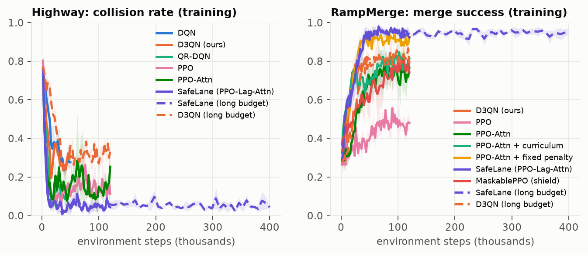

* *Left:* highway collision rate during training. PPO-family agents learn within about 20k steps. SafeLane (purple) stays lowest
  throughout, and the long-budget run (dashed) stays flat at about 5% (training uses exploration and denser random traffic).
* *Right:* ramp merge success during training. SafeLane and the fixed penalty climb above 90%, while plain PPO plateaus at about 45–50%.

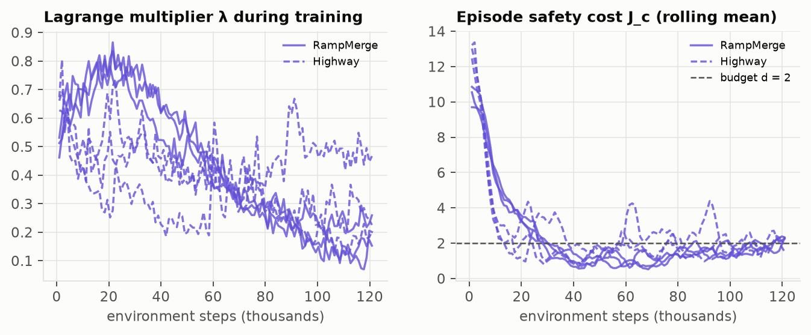

**This is the CMDP working as designed.**
* *Right panel:* the episode safety cost starts at 10–13 and is pushed down to the budget d = 2, where it stays.
* *Left panel:* λ rises while the agent is too unsafe (peaks of 0.6–1.0), then falls once the constraint is met. The agent then trades
  some margin back for speed.
* The final λ differs per task and seed: 0.12–0.23 on the ramp, 0.18–0.47 on the highway. No single hand-picked weight would match all of them.
* With a tighter budget the learned λ is larger: d = 0.5 settles at λ ≈ 1.7, while d = 8 drives it to 0.

## C4. Robustness to traffic density (including densities never seen in training)

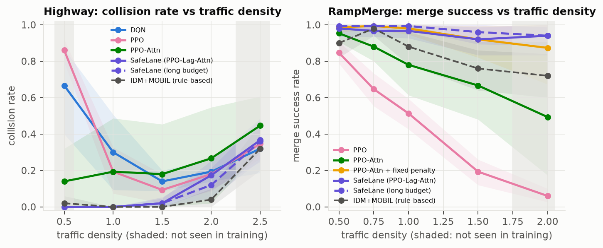

* **Ramp (right).** As traffic gets denser, unconstrained agents collapse: PPO goes from 85% to 6%, PPO-Attn from 95% to 49%, and the
  curriculum agent reaches 45% at 2×. The rule-based driver degrades from 90% to 72%. **SafeLane stays at 94% at 2× density, which it never saw in training.**
* **Highway (left): a sparse-traffic failure of the MLP agents.** At density 0.5 (below the training range), MLP agents crash a lot
  (PPO 86%, QR-DQN 68%, DQN 67%), while SafeLane stays at 0%. We watched the episodes
  ([`videos/highway_sparse_ppo.gif`](videos/highway_sparse_ppo.gif)): the MLP PPO keeps pressing FASTER at top speed and rear-ends a
  lone slower car. Dense training traffic rarely produced that situation, so the MLP never learned to brake for one leader.
  The attention network reasons per car.
* **Very dense highway traffic** (2.0× and 2.5×) is where the rule-based driver is best: 4% and 32% collisions, against SafeLane's 17% and 37%.
  At 2.5× every method crashes 31–55% of the time.

## C5. Robustness to imperfect sensors

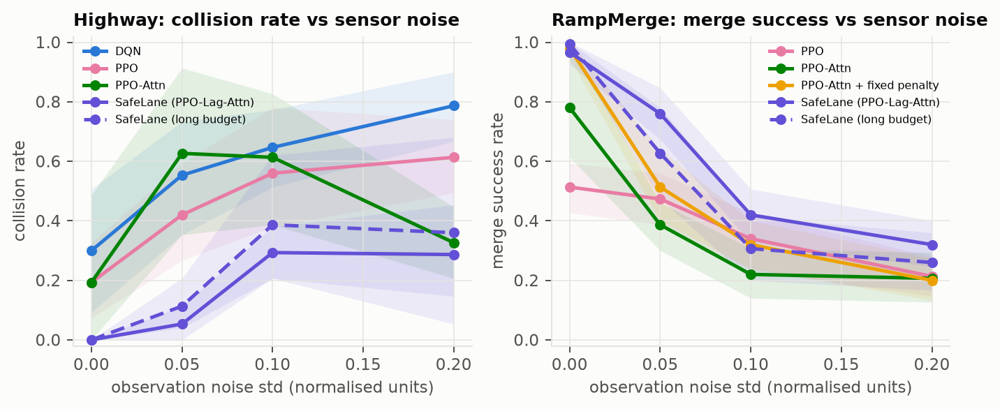

Sensor noise is the **weakest point of every learned agent**, and we report it plainly.
* **Highway, noise σ = 0.1** (about ±20 m position error): SafeLane has 29% collisions, against 56% for PPO and 65% for DQN. QR-DQN with CVaR is best at 19%.
* **One-step observation delay:** SafeLane still has 0% highway collisions, against 42% for PPO and 55% for DQN.
* **Vehicle dropout:** randomly hiding 30% of the cars hurts everyone (SafeLane 48% collisions).
* **Ramp, noise σ = 0.1:** SafeLane merges 42% of the time, PPO 34%. The shield agent is the most robust learned agent here (55%):
  masking lane changes is a crude but useful safeguard when inputs are noisy.
* **The rule-based driver reads the simulator's true state**, so perception noise cannot affect it (88% on the ramp in every noise
  scenario). That comparison is not fair to RL.
* All agents were trained on perfect observations. **Training with noise** is the obvious fix ([Part H](#part-h-limitations-future-work-and-what-we-learned-about-highway-env)).

## C6. Generalisation across tasks

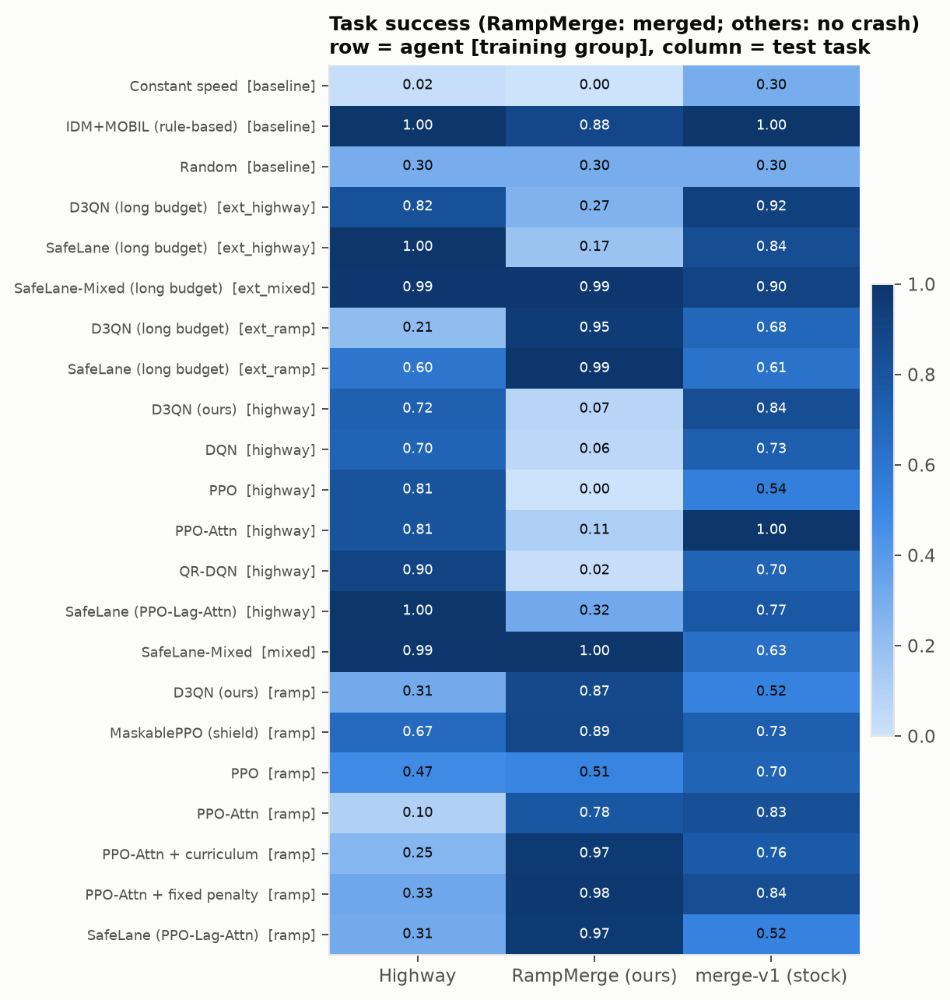

Each row is an agent ([group] = what it was trained on); each column is a test task.
* **Specialists fail at the other task.** Highway-trained agents merge only 0–32% of the time; ramp-trained agents drive the highway
  only 10–67% crash-free. Highway agents never saw a lane that ends; ramp agents saw only 2 lanes and short episodes.
* **SafeLane-Mixed** (trained on both) is the generalist: 99% highway, 99–100% ramp. On the stock `merge-v1` (a task neither was
  trained on) the long-budget version scores 90%.
* The rule-based driver needs no training and works everywhere it was designed for (100% highway, 100% stock merge, 88% ramp).

## C7. The safety-speed trade-off (Pareto front)

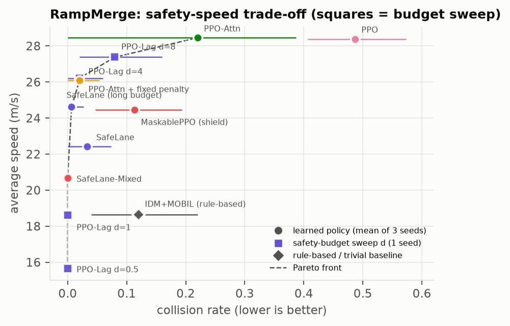

Each point is an agent: x is how often it crashes, y is how fast it drives. Up and to the left is better.
* The **purple squares** are the same SafeLane trained with different safety budgets d (one seed each):
  * d = 0.5: 100% success at 15.7 m/s;
  * d = 1: 100% at 18.6 m/s;
  * d = 4: 98% at 26.2 m/s;
  * d = 8: 92% at 27.4 m/s.
* **The budget is a dial that slides the agent along the trade-off**, and it is expressed in interpretable units ("unsafe seconds per episode").
* SafeLane, its long-budget version and SafeLane-Mixed lie on or near the Pareto front. Unconstrained PPO agents are fast but far to the right (unsafe).
  The rule-based driver is safe-ish but slow.

## C8. Aggregate scores (IQM across scenario families)

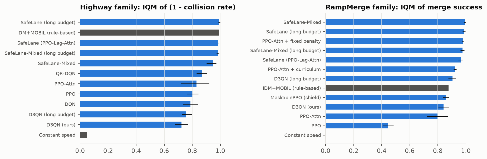

IQM over the 7 ramp and the 8 highway scenarios (95% stratified-bootstrap CI):
* **Ramp merge success:**
  * SafeLane-Mixed 0.995 [0.985, 1.0]
  * SafeLane (long) 0.989 [0.976, 0.996]
  * fixed penalty 0.978
  * SafeLane-Mixed (long) 0.976
  * SafeLane 0.964 [0.945, 0.976]
  * curriculum 0.924
  * IDM+MOBIL 0.876
  * MaskablePPO 0.856
  * D3QN 0.842
  * PPO-Attn 0.798
  * PPO 0.444
* **Highway safety (1 − collision):**
  * SafeLane (long) 0.992
  * IDM+MOBIL 0.990
  * SafeLane 0.985 [0.982, 0.988]
  * SafeLane-Mixed (long) 0.982
  * QR-DQN 0.870
  * PPO-Attn 0.830
  * PPO 0.802
  * DQN 0.787
  * D3QN 0.723

**Probability of improvement** (chance a random SafeLane run beats a random run of the other method):
* ramp: vs PPO 1.00, vs MaskablePPO 0.91, vs PPO-Attn 0.87 [0.73, 0.97], vs curriculum 0.69, vs fixed penalty 0.38 (a tie);
* highway: vs DQN 0.85, vs PPO 0.82, vs QR-DQN 0.79, vs PPO-Attn 0.75 [0.63, 0.88].

## C9. Explainability: what is the agent looking at?

| Attention per car slot (ramp) | Integrated-Gradients attribution (ramp) |
|:---:|:---:|
| 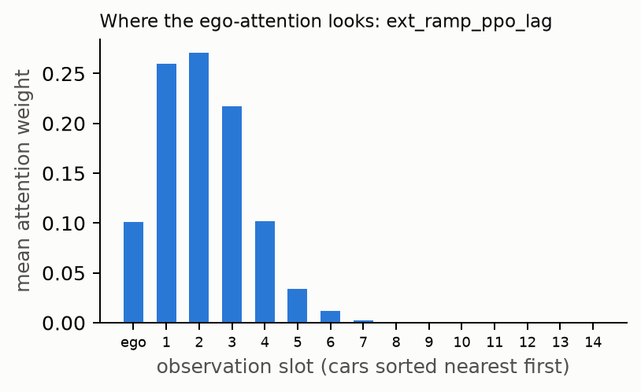 | 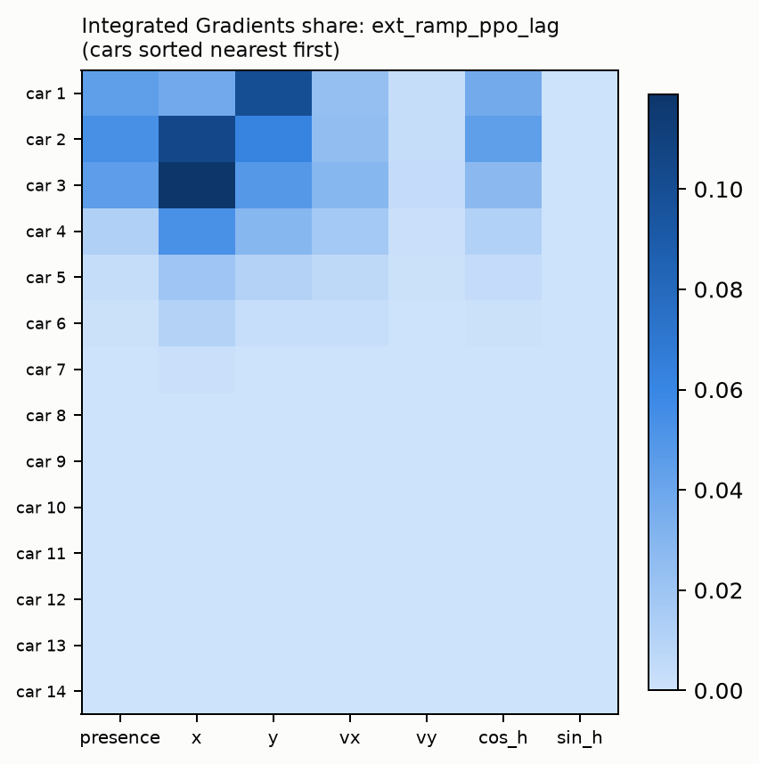 |

* SafeLane puts about **75% of its attention on the 3 nearest cars**, about 10% on itself, and almost nothing on cars 6 and beyond.
* Integrated Gradients (a gradient-based attribution method) agrees: decisions depend mostly on the **longitudinal position (x) of
  cars 2–3**, the cars around the gap it is merging into, and on the **lateral position (y) of the nearest car** (is it in my target lane?).
* The behaviour is local and sensible, and can be inspected; the GIFs show the attention live.

## C10. What more training bought (long-budget round)

| | 120k steps (50k for D3QN) | 400k (500k Mixed, 120k D3QN) |
|---|---|---|
| SafeLane, ramp success / speed | 96.7% @ 22.4 m/s | **99.3% @ 24.6 m/s** (safer *and* faster) |
| SafeLane, highway collisions / return | 0.0% / 33.0 | 0.7% / 32.8 (same) |
| SafeLane-Mixed, ramp success / speed | 100% @ 20.7 m/s | 98.7% @ 22.4 m/s |
| SafeLane-Mixed, stock merge-v1 | 63% | **90%** |
| D3QN, highway collisions | 36.0% | 29.3% |
| D3QN, ramp success | 87.3% | 95.3% |

* All agents improved or held steady with more training. The constrained agents turned extra training into more speed at the same safety.
* **More training is not free robustness.** The long-budget ramp SafeLane is *less* robust to sensor noise (31% vs 42% success at σ = 0.1)
  and the long-budget Mixed is worse at 2× ramp density (82% vs 96%). Longer training fits the training distribution more tightly.

---

# Part D: How our results compare to other RL projects

No two projects use identical settings (traffic density, number of cars, episode length, budget), so this is **context,
not a leaderboard**. Sources were checked in October 2026.

### Highway driving

| Project | Setup | Collision rate |
|---|---|---|
| Yousefz-z / highway-rl-generalization (GitHub) | highway-fast, SB3 defaults, 50k steps, 3 seeds × 100 eps | DQN **75%**, PPO **2%** (PPO rises to 69% at 1.5× density) |
| ricca200xx / Autonomous-Highway-Driving-with-DQN (GitHub) | DQN, 20 episodes | **15%** |
| sudhir-77 / rl-highway-planning (GitHub) | easy config: 3 lanes, **only 4 cars**, 12 s; best policy uses behaviour cloning | **1.5%** |
| Comprehensive DRL evaluation (arXiv 2306.11466) | highway-env roundabout / intersection, DQN and TRPO | 19–71% |
| **Ours: SafeLane** | **official highway-v0: 4 lanes, 50 cars, 40 s**, 3 seeds × 50 eps, CIs | **0.0%** (our own PPO: 33%, DQN: 9%) |

### Merging

| Project | Setup | Result |
|---|---|---|
| Comprehensive DRL evaluation (arXiv 2306.11466, Table IV) | stock highway-env merge | DQN **50%** collisions, TRPO **40%** |
| Li et al. 2025 (arXiv 2503.02624), research paper | ego on-ramp merge on highway-env; Lagrangian SAC-Discrete **plus an MPC safety controller** | **99.0–99.5%** success, 0.3–0.5% collisions |
| **Ours: SafeLane (long budget)** | our RampMerge, ego on the ramp, **no extra controller**, 3 seeds | **99.3%** success, 0.7% collisions; **94%** at 2× density |
| **Ours: SafeLane-Mixed** | same, one policy for highway + ramp | **100%** success (150/150) |

**Fair summary:**
1. **Highway.** We match the best student results in a much harder setting (50 cars instead of 4), with seeds and confidence intervals.
2. **Merging.** We are far ahead of standard DQN/TRPO baselines, and on par with a 2025 research method that adds a model-predictive
   safety controller (99.3% vs 99.0–99.5%). Our scenario is our own, so the comparison is indicative, not exact.
3. **Most projects do not test outside their training conditions.** Our density, noise and transfer tests are where the real differences show,
   including weaknesses (sensor noise) that average scores hide.

---

# Part E: Design choices and trade-offs

(The longer pre-implementation research, including the simulator, library and algorithm comparisons, is in
[`docs/design_and_tradeoffs.md`](docs/design_and_tradeoffs.md).)

| Decision | We chose | Alternatives | Why / trade-off |
|---|---|---|---|
| Simulator | **highway-env** | CARLA, MetaDrive, SUMO | Fast, pip-installable, has merges and reactive traffic, easy to subclass. *Cost:* 2-D, perfect perception, simplified physics. CARLA is photorealistic but about 100× slower and needs a big GPU |
| Train vs test env | train `highway-fast` (5 Hz), test `highway-v0` (15 Hz) | train on highway-v0 | highway-v0 is 11× slower (6.9 vs 76 steps/s measured). Testing on the harder official env keeps us honest |
| Library | **Stable-Baselines3** | RLlib, Tianshou, CleanRL | Reliable, documented, easy to extend. *Cost:* its DQN is plain (no Double/Dueling), so we wrote them. CleanRL single files would invite copying (plagiarism risk) |
| Action space | **discrete meta-actions** | continuous steering/throttle | Learns in minutes and matches the decision being studied (when to change lane or speed). *Cost:* coarse speed control. Continuous control must also learn lane-keeping and is much harder |
| Observation | **Kinematics list** | camera image (CNN), occupancy grid | Compact and fast. Images need about 5× more samples and a GPU. *Cost:* assumes perfect object detection |
| Network | **ego-attention** | MLP, LSTM | Order-invariant, any number of cars, interpretable, 3× fewer parameters. *Cost:* more complex, slightly slower per step |
| Algorithm family | **PPO** (+ DQN family for comparison) | SAC, A2C, Rainbow | PPO is stable and parallelises well, and Lagrangian constraints fit naturally into policy gradients. DQN is more sample-efficient on one core but was less reliable in our tests (C1, C2) |
| Safety method | **CMDP + PID Lagrangian** | reward penalty, shield, CPO, MPC/CBF safety filter | An interpretable budget, no hand-tuned weight, still pure RL. *Cost:* the constraint holds **on average**, not as a guarantee every episode. A formal guarantee needs a model-based filter (future work) |
| Shield | **ablation only** | always on | Rule-based (would weaken "strictly RL"), and it backfired (C2) |
| Traffic | **randomised IDM drivers** | fixed IDM, real trajectories (highD/NGSIM) | Diverse and cheap. Real-data replay is more realistic but non-reactive and a lot of work |
| γ | **0.9** | 0.8 (official), 0.99 | Long enough to anticipate a merge (~10 s); 0.99 slows learning with sparse crash signals |
| Seeds × episodes | **3 × 50** | 5–10 seeds | Compute-limited (10.5 CPU-h already). We report CIs instead of hiding the uncertainty |
| Compute | **CPU** | GPU | The simulator dominates (about 95% of time); small networks gain nothing on a GPU (SB3 docs agree) |

---

# Part F: Installation, usage and reproduction

## F1. Install (about 3 minutes)

Tested on Ubuntu, Python 3.12, highway-env 1.12.1, Stable-Baselines3 2.9.0, gymnasium 1.4.0, torch 2.14 (CPU).

```bash
git clone https://github.com/Osptium-Invincible/safelane-rl.git && cd safelane-rl
# uv (https://docs.astral.sh/uv/) is fastest; plain `python -m venv` + pip works too
uv venv --python 3.12 .venv && source .venv/bin/activate
uv pip install --index-url https://download.pytorch.org/whl/cpu torch     # CPU build is enough
uv pip install -e ".[demo,dev]"
pytest -q                                                                  # 32 tests, ~15 s
```

## F2. Watch the trained agents

```bash
# GIF of any trained agent on any scenario (scenarios: configs/experiment/eval.yaml)
python scripts/record_videos.py --run runs/ext_ramp_ppo_lag/seed0 --scenario ramp_density_2.0 --seed 10005
python scripts/record_videos.py          # re-create all README GIFs in videos/
python app/demo.py                       # interactive web demo at http://localhost:7860
```

## F3. Train

```bash
python scripts/train.py env=ramp_merge_dr algo=ppo_lag seed=0                 # SafeLane on the ramp (~5 min)
python scripts/train.py env=highway_dr algo=d3qn seed=0                       # our D3QN on the highway
python scripts/train.py env=[highway_dr,ramp_merge_dr] algo=ppo_lag           # one agent for both tasks
python scripts/train.py env=ramp_merge_dr algo=ppo_lag algo.lagrangian.cost_limit=1 algo.total_timesteps=300000
tensorboard --logdir runs/                                                    # live training curves
```

Configs are plain YAML: `configs/env/*.yaml` (road, traffic, randomisation) + `configs/algo/*.yaml` (observation,
action, network, hyperparameters, safety). Any key can be overridden on the command line with dotted paths.

| `env=` | | `algo=` | |
|---|---|---|---|
| `highway_fast` | 3 lanes, 20 cars | `dqn` | DQN |
| `highway` | official highway-v0 | `d3qn` | Double + Dueling + 3-step DQN |
| `highway_dr` | + random density and drivers | `qrdqn` | QR-DQN |
| `ramp_merge` / `ramp_merge_dr` | our RampMerge (+ randomisation) | `ppo` / `ppo_attn` | PPO with MLP / attention |
| `ramp_merge_curriculum` | density curriculum | `ppo_lag` | **SafeLane** |
| `ramp_merge_eval` | RampMerge at 15 Hz | `ppo_penalty` | fixed-λ ablation |
| `merge` | stock merge-v1 | `maskable_ppo` | shield ablation |

## F4. Reproduce every number in this README

```bash
make train      # 46 main runs  (configs/experiment/main.yaml), resumable, ~3 h
python scripts/run_experiments.py configs/experiment/extended.yaml   # 15 long-budget runs, ~3 h
make eval       # 49,250 evaluation episodes -> results/eval/{episodes.parquet,summary.csv}, ~50 min
make figures    # results/tables/*.md|.tex and figures/*.png
make check      # verify every number quoted in README.md and report/main.tex against the results
make videos     # videos/*.gif
make explain    # attention + Integrated-Gradients figures
```

Every stage skips work that is already done, so it can be interrupted and resumed. Trained models are included in
`runs/<name>/seed<k>/model.zip`, so you can skip training.

## F5. Repository layout

```
safelane/                     the Python package (all written for this project)
  envs/ramp_merge.py          RampMerge-v0: ego starts on the on-ramp, success flag
  envs/geometric_road.py      fix for highway-env's lane-linking bug on merge roads
  envs/vehicles.py            randomised / aggressive / cautious traffic drivers
  envs/fast_observation.py    numpy Kinematics observation (identical output, ~21% faster)
  envs/factory.py             builds an env + wrappers from a config dict; parallel envs
  wrappers/safety.py          TTC, headway, RSS, jerk, lane changes, CMDP cost, episode metrics
  wrappers/domain_randomization.py, reward_shaping.py, action_mask.py (shield), obs_noise.py
  agents/ppo_lagrangian.py    CMDP: r - λc reward transform + PID λ update
  agents/extractors.py        ego-attention network
  agents/d3qn.py              Double + Dueling DQN
  agents/registry.py          load any model; CVaR acting for QR-DQN
  baselines/policies.py       random, constant speed, IDM+MOBIL
  callbacks/                  training metrics logger, curriculum
  eval/runner.py, stats.py    parallel resumable evaluation; bootstrap CIs, IQM, P(improvement)
  xai/                        GIF recorder with attention overlay; Integrated Gradients
configs/                      env/, algo/, experiment/{main,extended,eval}.yaml
scripts/                      train, run_experiments, evaluate, make_figures, record_videos, explain, tune, check_numbers
app/demo.py                   Gradio demo           tests/   32 unit tests
runs/                         trained models + training logs (61 runs)
results/                      eval/summary.csv, eval/episodes.parquet, tables/
figures/, videos/             everything shown in this README
report/                       2-page report (LaTeX source + PDF)
docs/design_and_tradeoffs.md  pre-implementation research notes
```

---

# Part G: Viva preparation (likely questions with answers)

**Basics**

1. **What is RL and how is it different from supervised learning?** An agent learns by trial and error from a reward
   signal. There are no labelled correct answers, its actions change the data it sees, and rewards can be delayed. Supervised learning has a fixed labelled dataset.
2. **What are S, A and R in your project?**
   * S: a 5×5 (MLP) or 15×7 (attention) matrix of nearby cars (presence, relative x, y, vx, vy, heading).
   * A: 5 meta-actions.
   * R: speed + keep-right − crash (highway); speed + merge bonus − crash (ramp).
   * Plus a safety cost: TTC < 2 s, headway < 1 s, crash × 10.
3. **Is it really an MDP?** Approximately. The simulator state is Markov, but we see only nearby cars and not other drivers' intentions,
   so it is a POMDP. Velocities in the state remove most of the need for memory.
4. **What is γ and why 0.9?** The discount; effective horizon about 10 s. 0.8 (5 s) is too short to plan a merge; 0.99 learns slower.
5. **How do your agents explore?** DQN: ε-greedy from 1.0 to 0.05 over the first 30% of training. PPO: a stochastic policy plus an entropy bonus (0.01).
   Evaluation is deterministic.

**Algorithms**

6. **Explain DQN.** A neural Q-function trained towards r + γ max Q_target(s'), with a replay buffer and a target network.
7. **What do Double and Dueling DQN fix?** Double: the max operator over-estimates noisy values, so we select with the online network and evaluate with the target network.
   Dueling: Q = V(s) + A(s,a), so the state value is learned once and shared by all actions.
8. **Did your D3QN beat DQN?** Not on the highway (36% vs 8.7% collisions; 3 seeds with wide CIs). With more training D3QN improved to 29% on the highway and 95%
   ramp success. Honest conclusion: textbook DQN extensions did not give a reliable gain in our setting, and the PPO-based constrained agent was far more reliable.
9. **Explain PPO in one minute.** Actor-critic policy gradient. Advantages come from GAE. The update is clipped so the new policy's action
   probabilities stay within ±20% of the old ones, which keeps training stable. It is on-policy, so we use 8 parallel simulators.
10. **On-policy vs off-policy?** Off-policy (DQN) reuses old data from a replay buffer and is sample-efficient. On-policy (PPO) needs fresh data but is more stable and parallel.
11. **Why PPO and not SAC?** The actions are discrete and PPO is the standard, robust choice. A Lagrangian constraint fits naturally into
    policy-gradient training. Discrete SAC is known to be brittle.

**Safety**

12. **What is a CMDP?** An MDP plus a cost function and a budget: maximise reward subject to expected episode cost ≤ d.
13. **How does your Lagrangian work?** The agent maximises (r − λc)/(1+λ). After each 1,024-step rollout,
    λ = max(0, Kp·e + Ki·Σe) with e = (average episode cost − d), Kp = 0.05, Ki = 0.01. Too unsafe → λ grows; safe enough → λ shrinks.
14. **Why PID instead of plain gradient ascent on λ?** Pure integral updates lag and oscillate (overshoot the budget, then over-correct).
    The proportional term reacts immediately (Stooke et al. 2020).
15. **Why divide by (1+λ)?** It keeps the reward scale bounded as λ grows, so PPO's value function and advantages do not blow up.
16. **Is the constraint guaranteed?** No. It is satisfied **on average** during training. Individual episodes can violate it (SafeLane still crashes in 0.7–3.3% of merges).
    Hard guarantees need a model-based safety filter (MPC or control barrier functions), as in Li et al. 2025.
17. **Your fixed penalty did as well as SafeLane on ramp success. So why bother with the Lagrangian?**
    * At normal density it is a statistical tie (98.0% vs 96.7%, P = 0.38).
    * But the fixed penalty drives more aggressively: cost 3.2 vs 1.2, near-misses 18.7% vs 6.7%.
    * It does worse in unseen dense traffic: 87% vs 94% at 2×.
    * The learned λ ended at different values per task and seed (0.12–0.47). A fixed weight must be guessed and re-tuned for every task; the budget d is set once in interpretable units.
18. **Why did the shield make things worse?** It forbids unsafe merges but cannot teach the agent to wait. At 2× density, 43 of its 45 crashes were into the end-of-ramp barrier.
19. **What are TTC, headway and RSS?**
    * TTC = gap / closing speed.
    * Headway = gap / own speed (the 2-second rule).
    * RSS = Mobileye's formal minimum safe distance assuming worst-case braking. We report RSS violations as an independent check.
20. **Does the barrier count in your safety metrics?** For TTC and the safety cost, yes: hitting it is a crash. For headway and RSS, no: those are car-following measures, so they only consider vehicles.

**Architecture**

21. **Why attention?** It is order-invariant, handles any number of cars, and is interpretable. It has 46.7k parameters against 146k for the MLP.
    Without any constraint, PPO-Attn beats MLP PPO on the ramp (78% vs 51% success; 49% vs 6% at 2× density).
    On the highway, attention without the constraint was unreliable (18% collisions, seed-dependent).
22. **How does your attention layer work?** Each car goes through a shared 2-layer MLP to a 64-d embedding. The ego embedding is the query, all cars give keys and values,
    2-head attention runs with empty slots masked, followed by residual + LayerNorm + a linear layer to 64 features, which feed the policy and value heads.
23. **Why do MLP agents crash in sparse traffic?** They learned dense-traffic cues and, with few cars, keep accelerating into a lone slower car
    (PPO 86% collisions at half density). The attention model applies the same per-car reasoning everywhere (0%).

**Experiments and evaluation**

24. **How do you know it isn't luck?**
    * 3 training seeds per method, and 50 test episodes per scenario on seeds never used in training.
    * Hierarchical bootstrap 95% CIs, IQM, and probability of improvement.
    * For example, P(SafeLane > PPO-Attn on the ramp) = 0.87 [0.73, 0.97].
25. **What is IQM and why use it?** The mean of the middle 50% of scores. It is robust to outlier runs and more statistically efficient than the median (Agarwal et al. 2021).
26. **Why train on highway-fast but test on highway-v0?** highway-v0 is 11× slower to simulate. Testing on the harder official version
    (4 lanes, 50 cars, 15 Hz physics) shows the agent does not just exploit the fast simulator.
27. **What were the training vs test conditions?**
    * Training: randomised density (highway 0.7–2.0, ramp 0.5–1.5) and random driver types.
    * Testing: additionally densities 0.5 and 2.5 (highway) or 2.0 (ramp), plus sensor noise, dropout and delay, none of which were seen in training.
28. **Is the comparison fair?** Within each group, all methods share the same environment, budget, observation and evaluation seeds.
    The tables show each method's training budget, and long-budget runs are labelled.
29. **Where does the rule-based driver beat RL?**
    * Very dense highway traffic (4% vs 17% collisions at 2×).
    * Every sensor-noise test, because it reads the true simulator state.
    * It needs no training and transfers everywhere.
    * RL wins on driving efficiency, on merging (99% vs 88%) and on merging in dense traffic (94% vs 72%).
30. **What is the biggest weakness of your agent?** Sensor noise: 29% highway collisions at σ = 0.1, and ramp success drops to 42%. All agents were trained on perfect observations.

**Project-specific**

31. **Why build RampMerge?** The stock merge puts our car on the main road and has no success signal, so it cannot measure merging, which our proposal promised.
32. **What highway-env bug did you find?** The connected-lane neighbour search links road segments by lane index. On merge roads the ramp's index changes (0 → 2),
    so ramp cars saw main-road cars as their leader. We link segments by geometry instead (unit-tested).
33. **What bugs did your own review find, and what did you do?**
    * The observation's lateral scale was chosen per episode by highway-env, so ramp observations were clipped and highway train/test inputs mismatched.
    * The traffic speed factor was applied twice.
    * The rule-based baseline was weaker than it should be.

    We fixed everything, added tests, and **retrained and re-evaluated all 61 runs**. The first round is archived. Several conclusions changed.
    For example, the rule-based driver went from 44% to 88% merge success, and the curriculum turned out to help. That is why we report the final numbers only.
34. **What does "success" mean in each scenario?** Highway: no crash for the whole episode. Ramp: merged onto the main road and drove past x = 370 m without crashing.
    merge-v1: no crash until the end.
35. **Why is SafeLane slower than PPO?** Safety costs speed: SafeLane keeps a ≥ 1 s headway. The budget d moves it along the Pareto front (d = 8 gives 27.4 m/s).
    RampMerge lanes also have a 20 m/s limit that traffic obeys, so the 28 m/s agents are speeding.
36. **Did the curriculum help?** At normal density, yes (96.7% vs 78% for plain PPO-Attn; promoted through all levels by about 30k steps).
    But it collapsed at 2× density (45%), because its last level stops at 1.5×.
37. **What is CVaR acting?** QR-DQN predicts a distribution of returns. CVaR₀.₂₅ picks the action whose worst-25% outcomes are best.
    It cut highway collisions from 14.7% to 8.0%, and was the most noise-robust highway agent (19% at σ = 0.1).
38. **Why can't a single-task agent do the other task?** Highway agents never saw a lane that ends; ramp agents saw only 2 lanes and short episodes.
    Training on both (SafeLane-Mixed) fixes it: 99% highway and 99–100% ramp with one policy.
39. **Does more training always help?** Success went up for every long-budget agent, but robustness did not. The long ramp model is worse under noise (31% vs 42%), and the long Mixed model is
    worse at 2× density (82% vs 96%). Longer training fits the training distribution more tightly.
40. **Hyperparameters, and how were they chosen?** Mostly highway-env's published SB3 settings (lr 5e-4, batch 64, n_steps 128 × 8 envs, 10 epochs, clip 0.2), plus γ = 0.9,
    entropy 0.01 and a cost budget of 2. `scripts/tune.py` (Optuna) is included, but we did not run a large search because of compute.
41. **Why no GPU?** Profiling showed about 95% of time in the CPU simulator, and the networks are tiny. Running more parallel jobs was slower due to CPU contention (we measured it).
42. **How long does training take?** SafeLane: about 5 minutes for 120k steps, about 17–19 minutes for 400k. All 61 runs: 10.5 CPU-hours.
43. **What is Integrated Gradients?** It attributes a decision to input features by integrating gradients from an empty-road baseline to the real input.
    Ours shows decisions depend on the positions of the 2–3 nearest cars.
44. **Is anything in your project not RL?** The IDM+MOBIL driver (baseline only) and the shield (ablation only, reported separately). Every agent we propose is pure RL.
45. **What would a real car need?** The sim-to-real gap is large: real perception noise, vehicle dynamics, rare events, and validation under ISO 26262 / SOTIF.
    Our noise results show this is far from solved.
46. **What did you learn?**
    * Reward design and safety formulation matter more than the choice of algorithm.
    * Constraints give safer behaviour than penalties without tuning.
    * Testing outside the training distribution reveals what average scores hide.
    * Checking your own pipeline can change your conclusions.

---

# Part H: Limitations, future work, and what we learned about highway-env

**Limitations (be ready to state these yourself)**
* **Perfect perception during training.** The agents are fragile to sensor noise (C5); the rule-based driver is immune because it reads the true state.
* **Constraint on average only.** SafeLane still crashes in 0.7–3.3% of merges. There is no per-episode guarantee.
* **Very dense highway traffic.** At 2× density the rule-based driver crashes less (4% vs 17%).
* **Simplified world.** 2-D kinematics, simulated IDM drivers, no pedestrians, weather or sensor models. The sim-to-real gap is large.
* **3 seeds.** The confidence intervals are honest but some are wide (e.g. PPO-Attn 0–32%). The budget sweep uses 1 seed per point.
* **Ego position.** The observation's absolute-x feature saturates beyond 200 m (a highway-env design). On the ramp, the distance to the merge end is visible through the barrier's row.
* **Speed limit.** RampMerge lanes have a 20 m/s limit that traffic obeys but the ego's controller does not enforce.

**Future work**
* Noise and delay domain randomisation.
* An MPC or control-barrier-function safety filter, for per-episode guarantees.
* A curriculum extended beyond the training density range.
* Replaying real traffic (highD/NGSIM).
* Multi-agent cooperative merging.
* Continuous control.
* Recurrent policies for intention inference.

**highway-env findings worth knowing**
1. `merge-v0/v1` puts the ego on the main road; there is no ego-merge task and no success flag.
2. The connected-lane neighbour search links segments by lane index (bug on merge roads; fixed here).
3. **The Kinematics observation's lateral normalisation is computed once per episode from the lanes next to the ego**, unless
   `features_range` is set. It silently differs between roads; always set it explicitly.
4. highway-env calls `randomize_behavior()` right after creating each traffic car, so anything randomised in the constructor is randomised twice.
5. `merge-v0`, `roundabout-v0`, `exit-v0` and `intersection-v0/v1` are flagged out of date in 1.12; use v1 or v2. Merge environments never truncate.
6. `lane_change_reward` is silently ignored by `highway-v0`.
7. `SDL_VIDEODRIVER=dummy` produces black frames with pygame-ce. Do not set it; `rgb_array` mode already renders offscreen.
8. The observation builds pandas DataFrames on every step (about 20% of runtime); our numpy version produces identical output.
9. SB3 `SubprocVecEnv` workers each import torch (about 370 MB). `multiprocessing.set_forkserver_preload` shares that memory.

---

# References

1. E. Leurent. *An environment for autonomous driving decision-making (highway-env)*. GitHub, 2018. https://github.com/Farama-Foundation/HighwayEnv
2. A. Raffin et al. *Stable-Baselines3: Reliable RL implementations*. JMLR, 2021.
3. V. Mnih et al. *Human-level control through deep RL (DQN)*. Nature, 2015.
4. H. van Hasselt, A. Guez, D. Silver. *Deep RL with Double Q-learning*. AAAI, 2016.
5. Z. Wang et al. *Dueling network architectures for deep RL*. ICML, 2016.
6. W. Dabney et al. *Distributional RL with quantile regression (QR-DQN)*. AAAI, 2018.
7. J. Schulman et al. *Proximal Policy Optimization algorithms*. arXiv:1707.06347, 2017. J. Schulman et al. *GAE*. ICLR, 2016.
8. E. Altman. *Constrained Markov Decision Processes*. 1999.
9. C. Tessler, D. Mankowitz, S. Mannor. *Reward constrained policy optimization*. ICLR, 2019.
10. A. Stooke, J. Achiam, P. Abbeel. *Responsive safety in RL by PID Lagrangian methods*. ICML, 2020.
11. M. Alshiekh et al. *Safe RL via shielding*. AAAI, 2018. S. Huang, S. Ontañón. *Invalid action masking*. arXiv:2006.14171.
12. E. Leurent, J. Mercat. *Social attention for autonomous decision-making in dense traffic*. arXiv:1911.12250, 2019.
13. M. Treiber, A. Hennecke, D. Helbing. *Intelligent Driver Model*. Phys. Rev. E, 2000. A. Kesting et al. *MOBIL*. TRR, 2007.
14. S. Shalev-Shwartz, S. Shammah, A. Shashua. *On a formal model of safe and scalable self-driving cars (RSS)*. arXiv:1708.06374, 2017.
15. J. Tobin et al. *Domain randomization*. IROS, 2017. S. Narvekar et al. *Curriculum learning for RL*. JMLR, 2020.
16. M. Sundararajan, A. Taly, Q. Yan. *Axiomatic attribution for deep networks (Integrated Gradients)*. ICML, 2017.
17. R. Agarwal et al. *Deep RL at the edge of the statistical precipice*. NeurIPS, 2021.
18. Y. Li et al. *Human-aligned safe RL for highway on-ramp merging in dense traffic*. arXiv:2503.02624, 2025.
19. *Comprehensive training and evaluation on deep RL for automated driving in various simulated driving maneuvers*. arXiv:2306.11466, 2023.
20. GitHub comparisons: [Yousefz-z/highway-rl-generalization](https://github.com/Yousefz-z/highway-rl-generalization),
    [ricca200xx/Autonomous-Highway-Driving-with-Deep-Q-Learning](https://github.com/ricca200xx/Autonomous-Highway-Driving-with-Deep-Q-Learning),
    [sudhir-77/rl-highway-planning](https://github.com/sudhir-77/rl-highway-planning).
